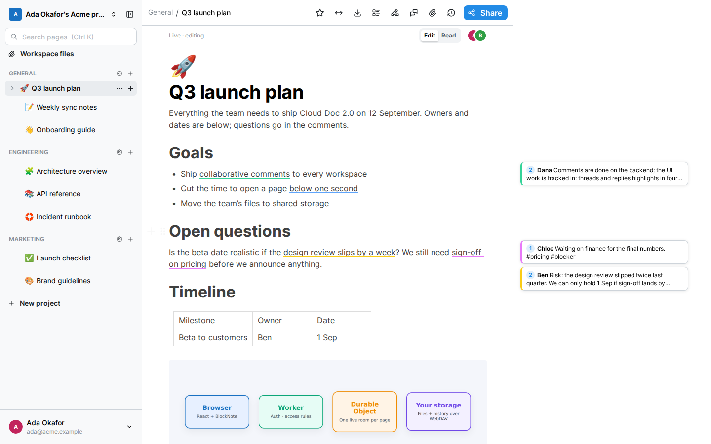
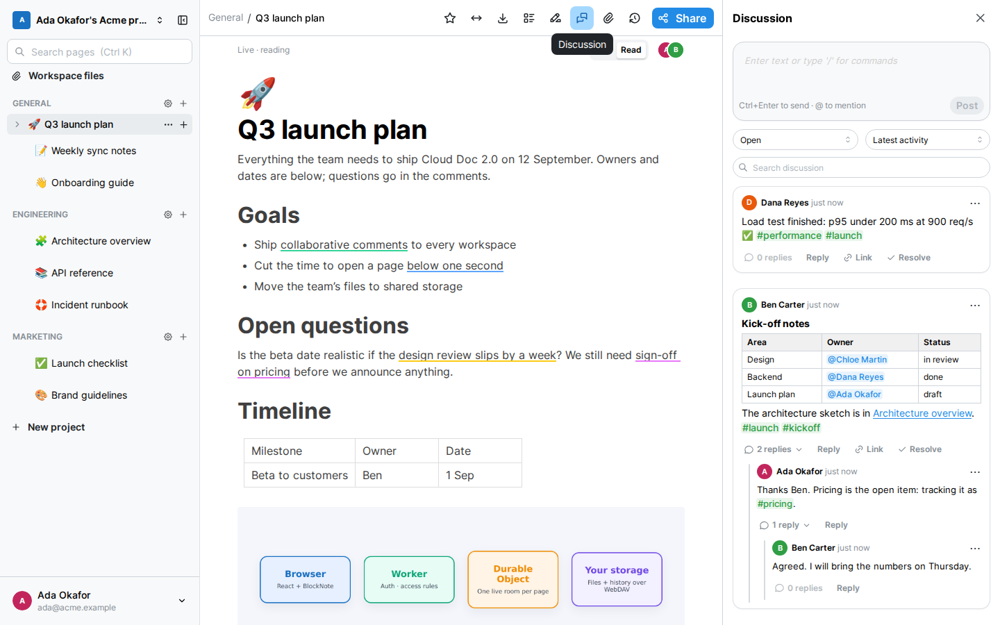
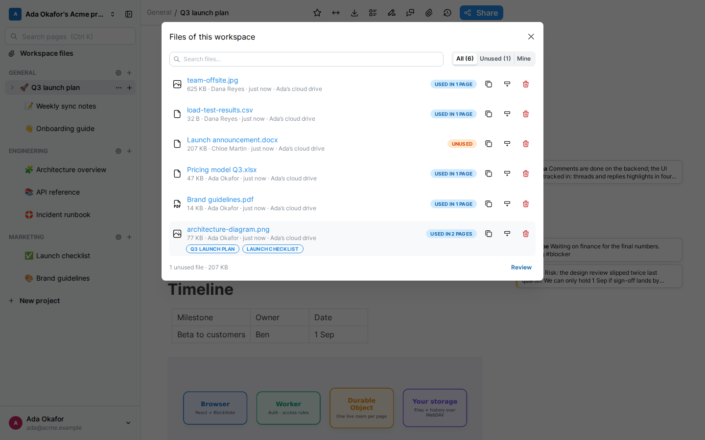
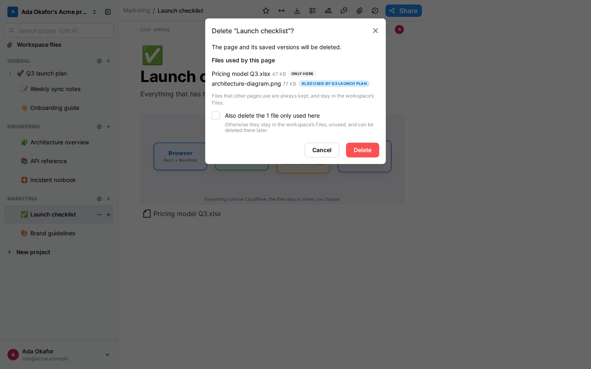
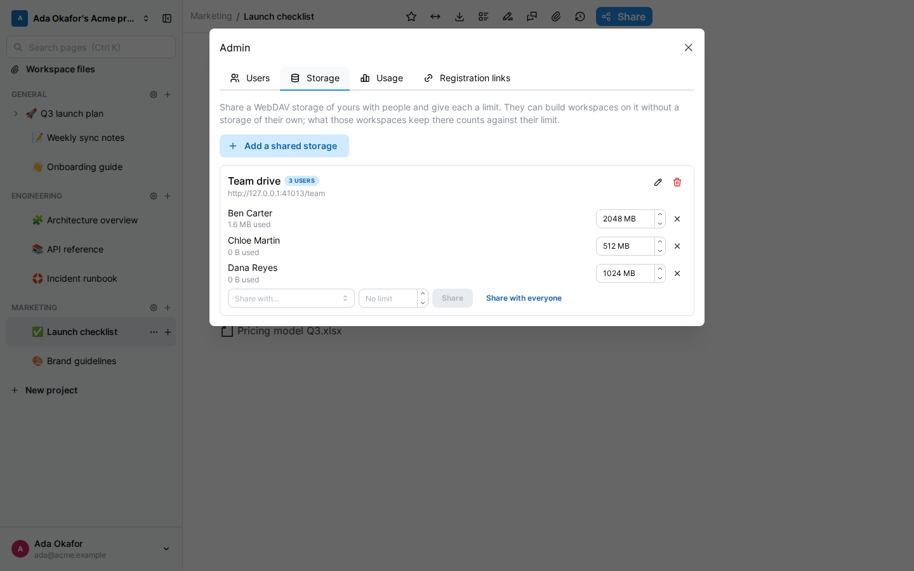
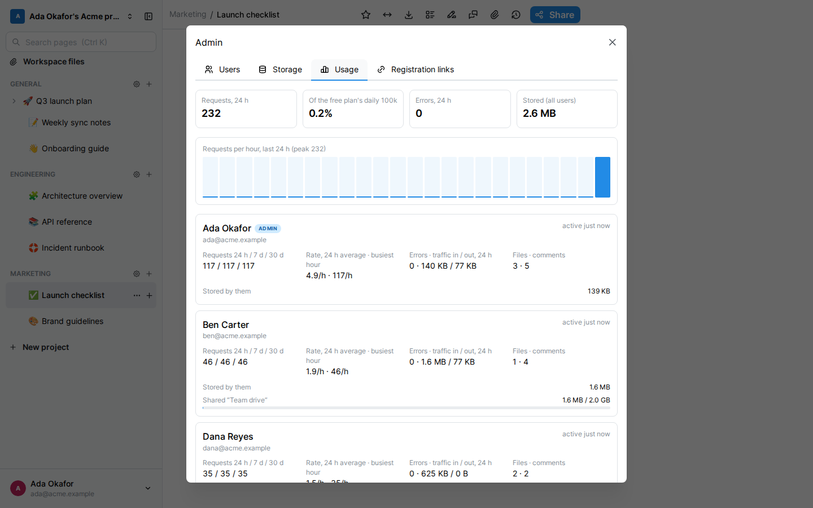
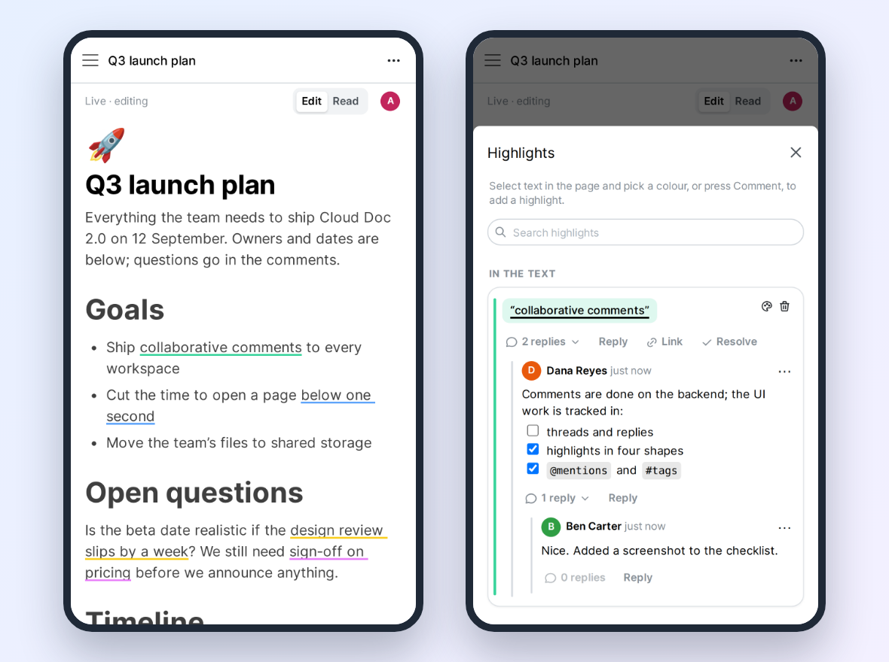
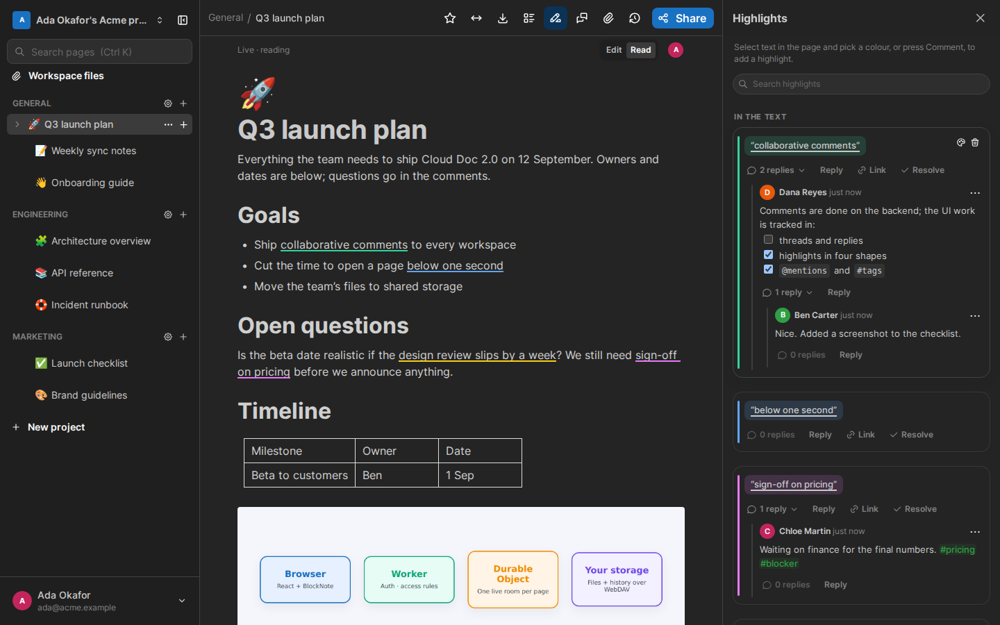

<div align="center">

# Cloud Doc

**A collaborative wiki that runs on Cloudflare, with comments you can think with, and files that stay in drives you choose.**

Real-time editing · Notion-style highlights and discussion · Workspaces and permissions · Zero servers to run

[](https://deploy.workers.cloudflare.com/?url=https://github.com/waxz/cloud-doc)

[Features](docs/FEATURES.md) · [Deploy](docs/DEPLOY.md) · [Security](docs/SECURITY.md) · [Develop](docs/DEVELOPMENT.md)

<br>


</div>

<br>

## Why Cloud Doc

<table>
<tr>
<td width="50%" valign="top">

### 🪶 Nothing to host
Workers, Durable Objects and D1: no server, no database to patch, no Redis. One command deploys it, and the **Free plan** is enough for a small team.

</td>
<td width="50%" valign="top">

### 🗂️ Your files, your drives
Files and page history live in **WebDAV storage** that people own (cloud-drive, Nextcloud, …), or that the admin shares with a limit per person. No storage, no workspace; no lock-in.

</td>
</tr>
<tr>
<td valign="top">

### 💬 Comments that work
Select text, pick a colour, and you have a **highlight**. Add words and it becomes a thread. A separate **discussion** panel handles the page as a whole, with `@mentions`, `#tags`, tables and links.

</td>
<td valign="top">

### 🔒 Careful by default
Every rule is checked on the server. Uploaded files are sandboxed, storage passwords are encrypted at rest, the app ships a strict content-security policy, and nothing leaves your Cloudflare account.

</td>
</tr>
</table>

## Take a tour

### Write together

Live cursors, a block editor with tables, code, LaTeX, PDFs and media, favorites, an outline, export to Markdown or PDF, history you can restore. Highlights that carry comments show a short preview in the margin; click it to open the full thread.



### Comment on anything

Click a comment beside the text to open its thread as a card right there, or open the whole panel, which takes the place of the margin comments in a right column of its own. The column is always reserved, so the page you are reading never shifts when a panel opens or closes; hide the page tree (`Ctrl/Cmd+\`) when you want the page wider. Click `#pricing` to see only the threads tagged with it; click a link to a highlight and the page scrolls to it.

<table>
<tr>
<td width="50%"></td>
<td width="50%"></td>
</tr>
<tr>
<td align="center"><sub><b>Highlights</b>: bound to the page, four shapes, seven colours</sub></td>
<td align="center"><sub><b>Discussion</b>: one card per thread, tables, <code>@members</code>, <code>#tags</code></sub></td>
</tr>
</table>

### Files that belong to the team, not to one page

A file can be used by many pages and survives them. The workspace's **Files** window shows who uploaded what and where it is used. Deleting a page asks what to do with its files; shared ones are never lost by accident.

<table>
<tr>
<td width="50%"></td>
<td width="50%"></td>
</tr>
</table>

### Find it fast

Search across everything you can see. Each page shows the matches with their context; click one and you land on that exact spot. `Ctrl/Cmd+K` from anywhere.


### Run it your way

The admin shares storage of their own with chosen people, each with a limit, and watches usage per user against the Free plan's daily quota.

<table>
<tr>
<td width="50%"></td>
<td width="50%"></td>
</tr>
</table>

### On every screen

A phone-first layout (slide-out page tree, bottom-sheet panels), a hideable page tree and full-width mode on the desktop, and a dark theme that follows your system.

<table>
<tr>
<td width="50%"></td>
<td width="50%"></td>
</tr>
</table>

## Features at a glance

| | |
| --- | --- |
| **Editing** | Real-time collaboration with live cursors · block editor · tables, code, LaTeX · inline PDFs that fit the page, with zoom, fit and page-jump tools (and highlights drawn on them), images, video, audio · undo/redo of your own changes · `Ctrl+S` versions · outline and word count |
| **Comments** | Highlights (4 shapes, 7 colours) in page order and a page-level discussion by thread · replies, resolve, search · rich text with links, tables and images · `@members` and `#tags` as filters · links that jump to the highlighted text |
| **Files** | Workspace-level files shared between pages · usage tracking · warnings before deleting something in use · delete-with-the-page choice |
| **Structure** | Workspaces → projects → nested pages · drag and drop · emoji icons · favorites · roles per project (viewer, commenter, editor, admin) |
| **Sharing** | Links for view, comment or edit, with subpages and expiry · view links publish a page without sign-in |
| **History** | Automatic and named versions, preview and restore, kept in your storage |
| **Search** | Accent-insensitive prefix search with in-context matches that jump to the spot |
| **Storage** | Per-workspace WebDAV storage · shared storages with per-user limits · encrypted credentials |
| **Admin** | Accounts and registration links that can add people to a workspace with a shared storage · shared storages · per-user usage, request rate and errors |
| **Everywhere** | Responsive layout for phones and tablets · dark theme · export to Markdown, HTML or PDF |

The full tour is in **[docs/FEATURES.md](docs/FEATURES.md)**.

## Cloud Doc and Docmost

[Docmost](https://github.com/docmost/docmost) (AGPL-3.0; Node, Postgres and Redis) is the closest open-source wiki, and a much more mature one. Cloud Doc takes a different route: no servers to run, files in drives that people own, and the Cloudflare Free plan as the target.

✅ yes · ➖ not yet (Cloud Doc) / not listed in its documentation (Docmost)

| | Cloud Doc | Docmost |
| --- | :---: | :---: |
| **Platform** | | |
| Runs without a server of your own | ✅ Cloudflare | ➖ Node + Postgres + Redis |
| Fits a free hosting tier | ✅ Workers Free | ➖ |
| Self-hostable, source on GitHub | ✅ | ✅ AGPL-3.0 core |
| **Writing** | | |
| Real-time collaboration, live cursors | ✅ | ✅ |
| Page history and restore | ✅ | ✅ |
| Tables, code, LaTeX, PDFs, media | ✅ | ✅ |
| Diagrams (draw.io, Excalidraw, Mermaid) | ➖ | ✅ |
| Embeds (Airtable, Loom, Miro, …) | ➖ | ✅ |
| Callouts, columns, tabs, table-of-contents block | ➖ | ✅ |
| Outline panel, favorites, Markdown / PDF export | ✅ | ✅ |
| **Comments** | | |
| Comments and replies, resolve | ✅ | ✅ |
| Coloured highlights in four shapes, with a short preview in the margin | ✅ | ➖ |
| `@member` / `#tag` as clickable filters | ✅ | ➖ |
| **Files and storage** | | |
| File attachments | ✅ | ✅ |
| Workspace file library (shared between pages, usage shown) | ✅ | ➖ |
| Files live in drives people own (WebDAV) | ✅ | ➖ server storage |
| Admin shares storage with per-person limits | ✅ | ➖ |
| **People and access** | | |
| Workspaces, projects/spaces, roles | ✅ | ✅ |
| Share and publish links | ✅ | ✅ |
| Groups | ➖ | ✅ |
| SSO / enterprise sign-in | ➖ | ✅ (some in the Enterprise edition) |
| Admin usage panel (storage, requests, rate per user) | ✅ | ➖ |
| **Polish** | | |
| Translations | ➖ English | ✅ 10+ |
| Page covers, labels, trash, duplicate page, templates | ➖ | ✅ |
| Email notifications and invites | ➖ no email sending | ✅ |

> The Docmost column follows its public README and documentation at the time of writing, and "not listed" means just that: please check [docmost.com](https://docmost.com) for the current feature set. Cloud Doc's gaps are on the roadmap below.

## Get started

1. **Deploy**: click the button at the top, or run `npm run deploy` from a clone ([deploy guide](docs/DEPLOY.md)).
2. **Create the first account**: it becomes the admin.
3. **Add a WebDAV storage** and create a workspace on it, then invite people.

```bash
git clone https://github.com/waxz/cloud-doc && cd cloud-doc
npm install
npm run deploy
```

Run it locally with `npm run dev` ([developer guide](docs/DEVELOPMENT.md)).

## How it works

```
 browser ──HTTP──▶ Worker ── checks access ──▶ D1   (accounts, permissions, comments, search)
    │                 └──────────────────────▶ the workspace's WebDAV storage (files, history)
    └─WebSocket─▶ Worker ── role ──▶ PageRoom Durable Object (one per page)
                                       ├─ Yjs sync + presence (read-only for viewers)
                                       ├─ saves the page to its own SQLite storage
                                       ├─ on save: title + text → D1 search, file usage
                                       └─ snapshots → the workspace's storage
```

| Piece | Built with |
| --- | --- |
| Editor and UI | [BlockNote](https://www.blocknotejs.org/) with Yjs collaboration · [Mantine](https://mantine.dev/) · [Tabler icons](https://tabler.io/icons) |
| Live sync | One Durable Object per page ([`y-partyserver`](https://github.com/cloudflare/partykit/tree/main/packages/y-partyserver)), hibernating WebSockets |
| Page content | The page's Yjs document, in its Durable Object's SQLite storage |
| Accounts, workspaces, permissions, comments, share links, search | D1 (search uses FTS5) |
| Files and page history | The workspace's WebDAV storage |

## Roadmap

Cloud Doc is young. What's done, and what comes next, roughly in order.

**Shipped**
- [x] Real-time editing, workspaces, projects, roles, share and publish links
- [x] Highlights and discussion with rich comments, tags and mentions
- [x] Workspace files, usage tracking and safe deleting
- [x] Storage per workspace, shared storages with per-user limits, encrypted credentials
- [x] Search with in-context matches, outline, favorites, export, undo/redo, dark theme, phone layout
- [x] Admin usage panel, security headers, sandboxed uploads

**Next**
- [ ] **Open sign-up** switch for admins (sign-up is by registration link only today)
- [ ] **Trash**: restore deleted pages (deleting is permanent today)
- [ ] **Diagrams**: Mermaid and draw.io blocks
- [ ] **Callout** and **table-of-contents** blocks
- [ ] **Page duplication**, **labels**, recent pages
- [ ] **Groups**: give access to many people at once

**Later**
- [ ] Email: invites, password reset and notifications (through Cloudflare Email or an SMTP relay)
- [ ] Single sign-on (OIDC) and two-factor sign-in
- [ ] Page templates and covers
- [ ] Translations (the interface is English only today)
- [ ] API tokens and webhooks
- [ ] Comment on images and diagrams

Have an idea or a missing piece? Open an issue.

## Security

Access is checked on the server for every request; live sync gets its role from the Worker, never from the client. Uploaded files are served sandboxed, comments never render raw HTML, the app ships a strict content-security policy, and saved storage passwords are encrypted with a key only your Worker holds. What the app leaves to you (no email verification or two-factor sign-in, no API rate limit beyond failed sign-ins) is spelled out in **[docs/SECURITY.md](docs/SECURITY.md)**.

## Documentation

| | |
| --- | --- |
| [docs/FEATURES.md](docs/FEATURES.md) | Everything it does, in detail |
| [docs/DEPLOY.md](docs/DEPLOY.md) | Deploying, configuration, the storage key, the Free plan |
| [docs/SECURITY.md](docs/SECURITY.md) | What is protected and what is left to you |
| [docs/DEVELOPMENT.md](docs/DEVELOPMENT.md) | Running locally, tests, project layout, regenerating screenshots |
